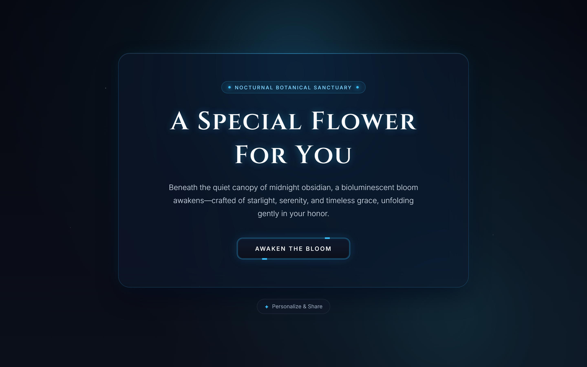
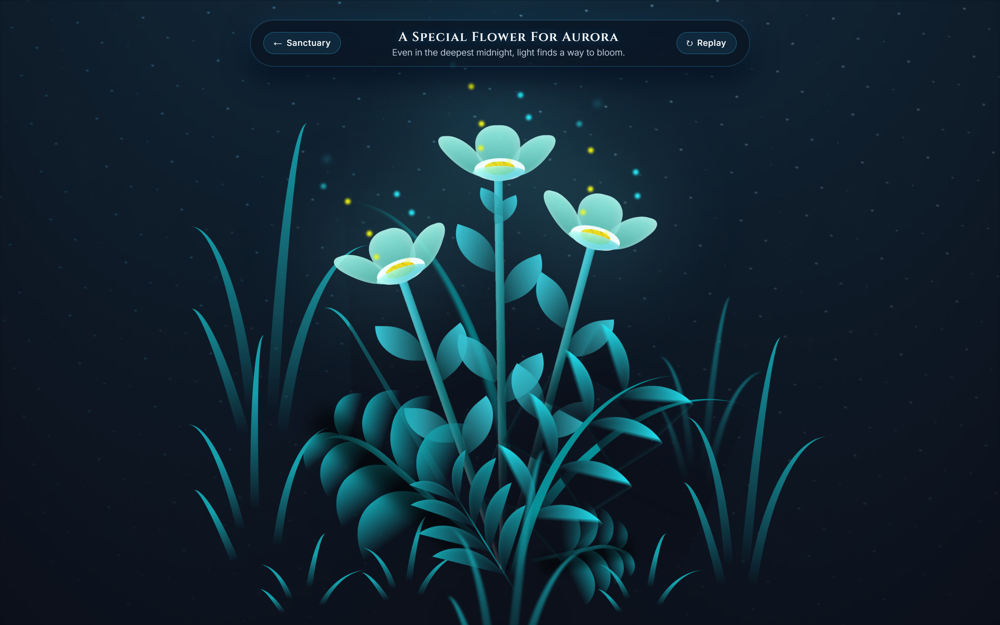

<div align="center">

# 🌌 Night Bloom

**An Interactive Bioluminescent Botanical Experience in Midnight Obsidian & Cyan Starlight**

[](./LICENSE)
[](https://developer.mozilla.org/en-US/docs/Web/Guide/HTML/HTML5)
[](https://developer.mozilla.org/en-US/docs/Web/CSS)
[](https://developer.mozilla.org/en-US/docs/Web/JavaScript)
[](https://pages.github.com/)

<p align="center">
  <em>"Beneath the quiet canopy of midnight obsidian, a bioluminescent bloom awakens—crafted of starlight, serenity, and timeless grace."</em>
</p>

</div>

---

## ✨ Overview

**Night Bloom** is a lightweight, zero-dependency interactive web experience that pairs a **Midnight Obsidian (`#0B0F19`)** and **Bioluminescent Cyan (`#38BDF8`)** glassmorphic portal with a pure-CSS 3D botanical bloom animation.

Designed to be universally shareable, anyone can personalize the dedication on the fly via URL query parameters or the built-in **Personalize & Share** bar—requiring zero backend, build steps, or external frameworks.

---

## 🖼️ Visual Preview

### 1. Sanctuary Portal (`index.html`)


### 2. Bioluminescent Bloom (`flower.html`)


---

## 🎨 Key Features

- **Luxury Editorial Typography:** Pairs **Cinzel** & **Playfair Display** for serene display titles with **Inter** for crisp, modern supporting prose.
- **Midnight Obsidian & Bioluminescent Cyan Aesthetics:** Harmonized color system (`#0B0F19` obsidian backdrop with `#38BDF8` bioluminescent cyan accents and frosted glassmorphism).
- **Word-Safe Responsive Typography:** Staggered character-level bioluminescent glow animation grouped inside word-safe containers (`<span class="word">`) so headings never break mid-word on mobile or tablet viewports.
- **Dynamic URL Personalization:** Customize the recipient's name and poetic subtitle dynamically via URL parameters (`?name=...&msg=...`) with an automatic universal fallback: **"A Special Flower For You"**.
- **Built-in Share Link Generator:** Includes an interactive **Personalize & Share** drawer to preview a custom recipient name and copy the shareable URL in one click.
- **Pure CSS 3D Botanical Engine:** Multi-layered petals, stems, swaying grass blades, and rising bioluminescent light motes orchestrated entirely with CSS keyframes and 3D transforms.

---

## 🔗 URL Customization Guide

You can personalize **Night Bloom** for anyone simply by appending query parameters to the URL:

| Parameter | Description | Fallback (Default) | Example |
| :--- | :--- | :--- | :--- |
| `?name=` | Recipient's name displayed in the glowing title and flower HUD | `A Special Flower For You` | `?name=Aurora` → **A Special Flower For Aurora** |
| `?msg=` | Optional custom poetic message below the main greeting | *Default nocturnal verse* | `?name=Aurora&msg=May+your+night+always+shine` |

### Example Shareable Links

- **Universal Default (No Parameters):**
  ```text
  https://<your-username>.github.io/night-bloom/
  ```
  *Displays: "A Special Flower For You"*

- **Personalized Recipient Name:**
  ```text
  https://<your-username>.github.io/night-bloom/?name=Aurora
  ```
  *Displays: "A Special Flower For Aurora"*

- **Personalized Name + Custom Message:**
  ```text
  https://<your-username>.github.io/night-bloom/?name=Aurora%20Celeste&msg=Wishing%20you%20starlight%20and%20serenity%20tonight.
  ```

---

## 📂 Project Structure

```text
night-bloom/
├── css/
│   ├── main.css              # 3D bioluminescent flower animation & HUD styles
│   ├── main.css.map          # CSS source map
│   └── style.css             # Landing portal glassmorphism, typography & responsive layout
├── img/
│   ├── flowers.png           # Favicon & botanical emblem
│   ├── preview-landing.png   # Sanctuary landing page preview
│   └── preview-bloom.png     # Blooming flower stage preview
├── scss/
│   └── main.scss             # SCSS source variables & typography rules
├── .gitignore                # Standard Git ignore rules
├── flower.html               # Interactive 3D bioluminescent flower stage
├── index.html                # Glassmorphic greeting portal & link personalizer
├── LICENSE                   # MIT License
├── main.js                   # Vanilla JS URL parameter parser & animation controller
└── README.md                 # Project documentation
```

---

## 🚀 Quick Start (Local Development)

Because **Night Bloom** is built with pure HTML, CSS, and Vanilla JavaScript, no package installation or build step is required.

1. **Clone the repository:**
   ```bash
   git clone https://github.com/4jeeh/night-bloom.git
   cd night-bloom
   ```

2. **Start a local HTTP server:**
   ```bash
   # Using Python 3
   python -m http.server 8080
   ```
   *(Alternatively, use VS Code Live Server or `npx serve .`)*

3. **Open in your browser:**
   - Default view: `http://localhost:8080`
   - Personalized view: `http://localhost:8080/?name=Aurora`

---

## 🌐 Deploying to GitHub Pages

1. Push your repository to GitHub (`https://github.com/<your-username>/night-bloom`).
2. Navigate to your repository **Settings** → **Pages** in the left sidebar.
3. Under **Build and deployment**:
   - **Source:** Select **Deploy from a branch**.
   - **Branch:** Select `main` and folder `/ (root)`, then click **Save**.
4. Wait ~60 seconds for the deployment action to complete. Your live site will be available at:
   ```text
   https://<your-username>.github.io/night-bloom/
   ```

---

## 📄 License

Distributed under the **MIT License**. See [`LICENSE`](./LICENSE) for full details.